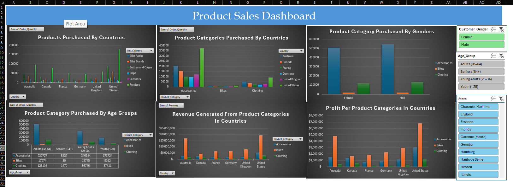

Interactive Excel dashboard analysing 113,036 sales records (Jan 2011 to Jul 2016) across products, countries and customer segments.

## Overview
This project turns a raw sales dataset from a bike store in Europe into an interactive dashboard. It shows which products, markets and customer groups drive quantity, revenue and profit.

## Tools
Microsoft Excel: PivotTables, PivotCharts, Slicers

## Dataset
- 113,036 rows and 15 columns: date, customer age, age group, gender, country, state, product category, sub-category, product, quantity, unit cost, unit price, cost, revenue and profit.
- Source: Bike Store Sales in Europe  https://www.kaggle.com/datasets/serhatabuk/sales-data-csv 

## Data Preparation
1. Imported the raw CSV into Excel.
2. Validated the data: no missing values, and cost, profit and revenue reconcile.
3. Converted `Date` to a proper date type.
4. Removed redundant `Day`, `Month` and `Year` columns.
5. Standardised gender labels (`M`/`F` to `Male`/`Female`).
6. Built PivotTables, PivotCharts and slicers for gender, age group and state.

## Dashboard Contents
- Products purchased by gender, age group and country
- Most purchased product categories by country
- Revenue by product category and country
- Profit by product category and country

## Key Findings
- **Totals:** $85.3M revenue and $32.2M profit, a 37.8% margin.
- **Bikes vs Accessories:** Bikes generate 72.5% of revenue but only 2.7% of units. Accessories make up 78% of units at a 58.6% margin, the highest of any category.
- **Top sub-category:** Road Bikes bring in 39% of revenue, but at a 30.2% margin, lower than Mountain Bikes (38.6%).
- **Markets:** the US (32.8%) and Australia (25.0%) lead on revenue. Canada has the highest margin (46.8%).
- **Concentration:** 53 of 130 products generate 80% of revenue.
- **Low margins:** Caps and Jerseys earn about 14%, well below the overall margin.
- **Customers:** gender is evenly split (50.8% male, 49.2% female), and ages 35 to 64 account for about half of revenue.

## How to Use
Download `sales_dashboard.xlsx` and open it in Excel. Use the slicers on the dashboard sheet to filter by gender, age group and state.

## Author
Emmanuel Adjei-Mensah | [LinkedIn](https://linkedin.com/in/eamensah) | [Portfolio]
